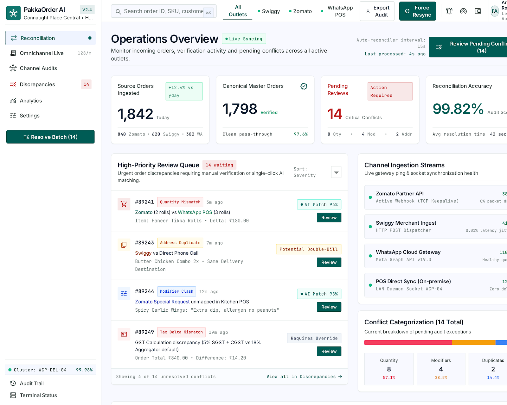
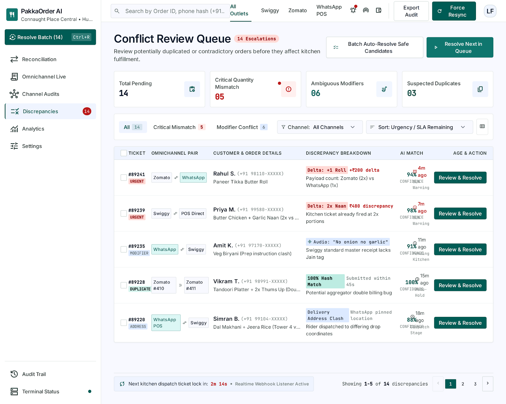
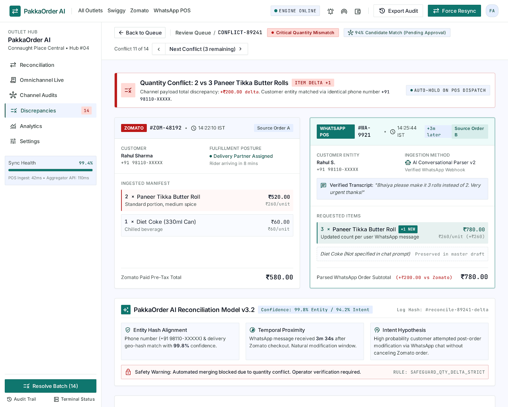
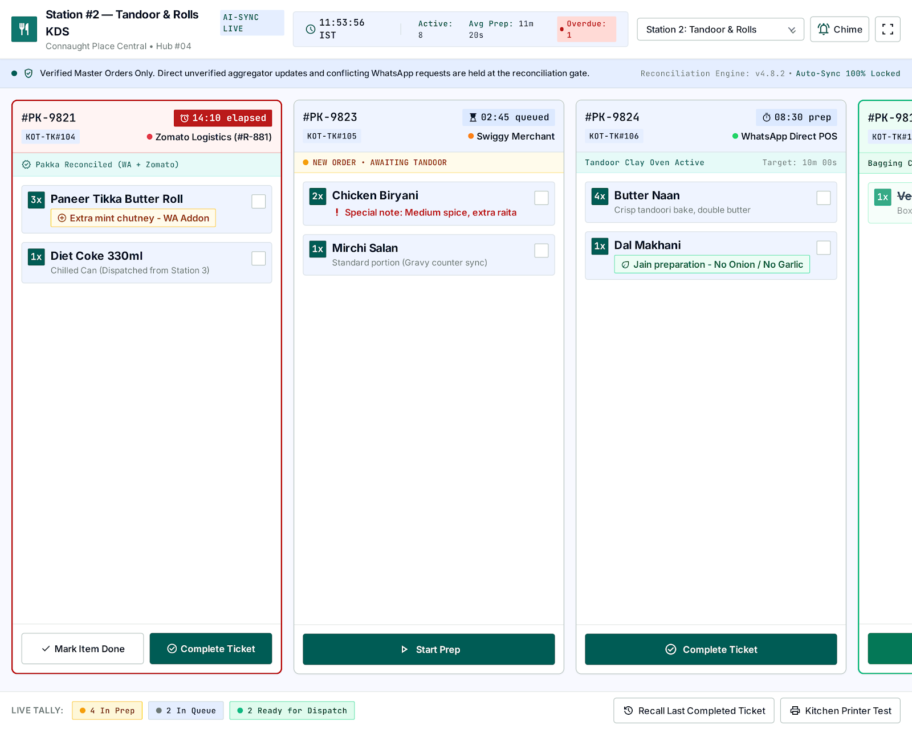
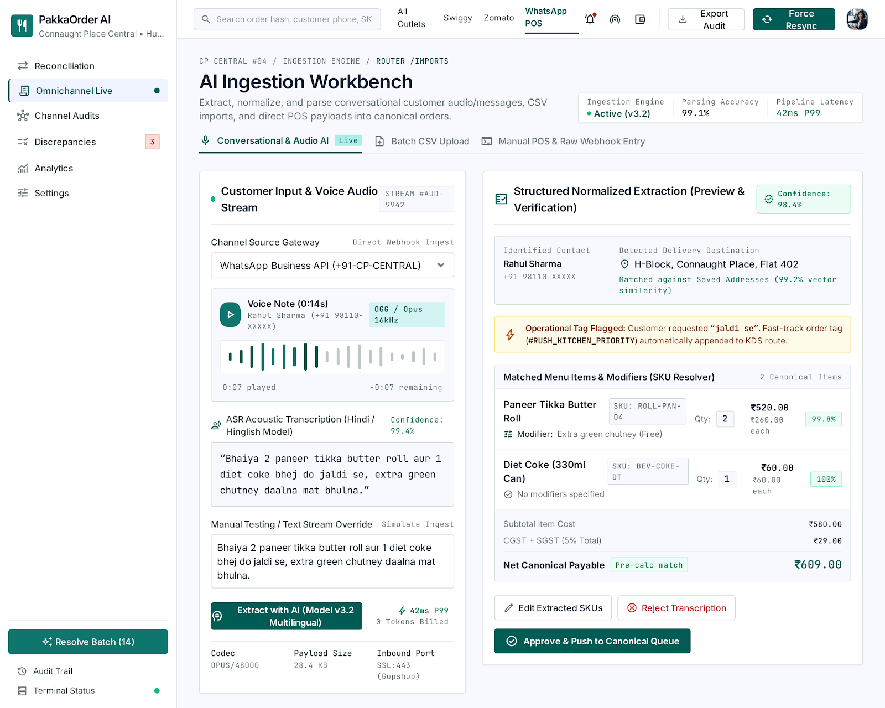
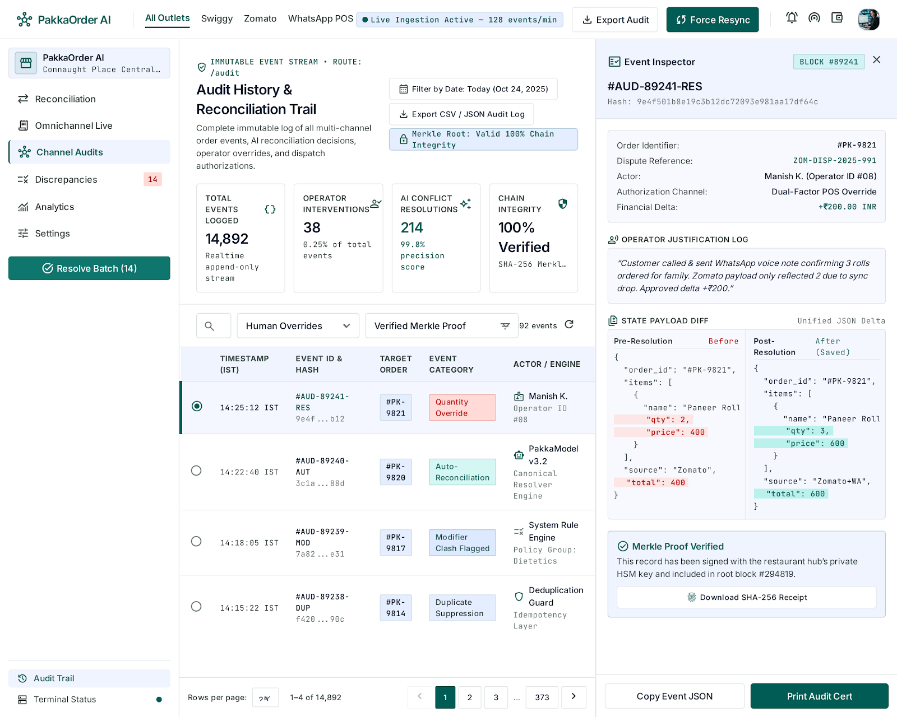

# PakkaOrder AI

**Many Channels. One Pakka Order.**

> AI-Powered Multilingual Restaurant Order Reconciliation and Conflict Resolution Platform.

---

## 1. Project Overview

In busy multi-outlet restaurants, cloud kitchens, and retail food operations, orders flood in through fragmented channels: WhatsApp customer chats, incoming phone calls, in-store Point-of-Sale (POS) terminals, and third-party delivery platforms like Zomato and Swiggy. 

When a customer orders via a delivery aggregator and then texts the restaurant on WhatsApp saying *"Bhaiya, make it 3 rolls instead of 2 and send extra green chutney"*, chaos ensues. Traditional aggregators and standalone POS systems treat these events as completely disconnected transactions—leading to double kitchen preparation, incorrect billing, inventory waste, and frustrated diners.

**PakkaOrder AI** solves this critical operational bottleneck. Operating as an intelligent reconciliation layer, it ingests unstructured multi-channel inputs, uses Google Gemini AI to interpret multilingual conversational Hindi/English instructions, scores cross-channel duplicate probability, isolates field-level quantity conflicts, and guides kitchen and floor managers to reconcile orders into a single, verified **Canonical Master Order**.

---

## 2. Problem Statement

Modern food service operators face acute friction at the point of order aggregation:

1. **Multi-Channel Fragmentation:** Orders arrive simultaneously via POS terminals, phone transcripts, delivery marketplaces, and direct messaging channels.
2. **Unstructured Customer Modifications:** Patrons frequently submit late adjustments, quantity changes, and dietary notes over chat (*"rolls 2 ke badle 3 kar do"*).
3. **Ghost Duplicates vs. Genuine Repeat Orders:** Identifying whether two nearby orders from the same customer represent an accidental duplicate entry or two distinct meals requires subtle temporal, geo-spatial, and item-similarity analysis.
4. **Kitchen Over-Preparation & Material Discrepancies:** Automatic or naive overwriting leads to mismatched bills and double billing. Conversely, ignoring updates results in incorrect dispatches and customer churn.

---

## 3. Proposed Solution

PakkaOrder AI introduces an intelligent, human-supervised reconciliation pipeline:

```
[ Multi-Channel Ingestion ] (WhatsApp Cloud API / Webhooks, POS, Aggregator CSVs, Manual Entry)
           ↓
[ AI Extraction & Normalization ] (Gemini Multilingual Parsing → Zod Runtime Schema Validation)
           ↓
[ Deterministic Matching Engine ] (Customer Entity, Phone Hash, Time-Window & Jaccard Item Matching)
           ↓
[ Conflict Detection & Scoring ] (Quantity Mismatches, Price Variance, Special Instruction Diffs)
           ↓
[ Human-Verified Reconciliation ] (Side-by-Side Review Queue: Single Canonical Order Selection)
           ↓
[ Master Canonical Order & KDS ] (Dispatched to Kitchen Display, Audited with HMAC-SHA256 Signatures)
```

### Core Operating Principle
**AI outputs are recommendations, never unilateral decisions.** Material quantity conflicts strictly require human operator confirmation before any order record is merged or updated. Duplicate records are linked without summing quantities, guaranteeing source evidence remains immutable.

---

## 4. Key Features

- **Multi-Channel Order Ingestion:** Ingest orders from WhatsApp Cloud API webhooks, delivery marketplace CSV exports, direct POS integration payloads, and manual staff inputs.
- **Multilingual AI Order Extraction:** Utilizes Google Gemini to parse colloquial, multilingual conversational Hindi-English messages into structured, catalog-matched line items.
- **Runtime Schema Validation:** All AI extractions are strictly validated against strict Zod runtime schemas before any persistence or business logic execution.
- **Intelligent Duplicate Candidate Scoring:** Multi-factor scoring engine evaluating customer identity (phone hash, delivery address), temporal proximity (rolling time window), and item overlap (Jaccard similarity index).
- **Quantity Conflict Detection:** Material discrepancy alerts automatically trigger when item quantities differ between matched source records.
- **Human-Verified Reconciliation Workspace:** High-contrast side-by-side comparison interface enabling operators to inspect source evidence, select winning quantities, and record reconciliation rationales.
- **Canonical Master Orders:** Creates unified, validated master records linked to underlying source evidence with full provenance tracking.
- **Tamper-Proof Audit History:** Immutable audit trail signed with HMAC-SHA256 cryptographic signatures to satisfy enterprise operational and financial compliance.
- **Real-Time Kitchen Display System (KDS):** Purpose-built high-contrast ticket board displaying unified orders organized by kitchen status (*New, Preparing, Ready*) with elapsed-time monitors and priority indicators.
- **Product Catalog & Alias Directory:** Menu management with support for dish aliases, price variations, and category mappings used to ground AI entity resolution.
- **Executive Operations Dashboard:** Real-time visibility into channel volume, conflict rates, resolution velocity, and kitchen prep queues.
- **Modern Responsive SaaS UI:** Built with React 19, TypeScript, Vite, and Tailwind CSS, following the clean, high-contrast Google Stitch light design system (`#f8f9ff`).

---

## 5. Technology Stack

| Layer | Technology | Purpose |
|---|---|---|
| **Frontend Framework** | React 19 | Declarative user interface with concurrent rendering |
| **Language** | TypeScript (Strict Mode) | End-to-end type safety and contract integrity |
| **Build Tool** | Vite 8 | Instant Hot Module Replacement and production bundling |
| **Styling** | Tailwind CSS | Utility-first styling aligned to the Google Stitch design tokens |
| **Icons** | Lucide React | High-legibility operational and action iconography |
| **Backend Runtime** | Node.js (ES Modules) | High-throughput asynchronous server runtime |
| **API Framework** | Express.js | Modular REST API with strict controller-service-repository layering |
| **AI Engine** | Google Gemini API (`@google/genai`) | Multilingual conversational extraction and explanation generation |
| **Schema Validation** | Zod | Runtime validation of untrusted inputs and AI outputs |
| **Database** | MySQL 8+ | Relational storage with foreign key constraints and ACID transactions |
| **Testing** | Vitest & Supertest | Automated unit, repository, and integration test suites |

---

## 6. System Architecture

PakkaOrder AI is designed as an understandable, modular monolith with distinct separation between presentation, HTTP routing, domain services, and database persistence:

```
┌────────────────────────────────────────────────────────┐
│                   React 19 Frontend                    │
│   (Dashboard, Orders, Review Queue, KDS, Settings)     │
└──────────────────────────┬─────────────────────────────┘
                           │ HTTP / JSON
┌──────────────────────────▼─────────────────────────────┐
│                 Express REST API Layer                 │
│      (Rate Limiting, CORS, Parameter Validation)       │
└───────┬──────────────────┬──────────────────┬──────────┘
        │                  │                  │
┌───────▼────────┐ ┌───────▼────────┐ ┌───────▼──────────┐
│ Ingestion &    │ │ Matching &     │ │ Audit &          │
│ WhatsApp Cloud │ │ Reconciliation │ │ Compliance       │
│ Webhook Parser │ │ Engine         │ │ (HMAC Signatures)│
└───────┬────────┘ └───────┬────────┘ └───────┬──────────┘
        │                  │                  │
        │           ┌──────▼────────┐         │
        │           │ Google Gemini │         │
        │           │ Gen AI SDK    │         │
        │           └───────────────┘         │
        │                                     │
┌───────▼─────────────────────────────────────▼──────────┐
│              MySQL 8+ Relational Database              │
│  (tenants, source_orders, canonical_orders, audit_log) │
└────────────────────────────────────────────────────────┘
```

---

## 7. How It Works

1. **Ingest:** An order is ingested through a WhatsApp webhook, delivery aggregator CSV import, or POS payload.
2. **Extract:** If unstructured text or audio notes are present, the backend invokes Google Gemini to parse items, quantities, and instructions against the restaurant's active menu catalog.
3. **Match:** The deterministic matching engine queries existing active orders within the tenant's rolling time window and computes multi-signal confidence scores.
4. **Flag:** If duplicate signals exceed the review threshold or a quantity mismatch is detected, a `DuplicateCandidate` record is generated and flagged with `CONFLICT_DETECTED`.
5. **Review:** Kitchen staff review the conflict in the side-by-side reconciliation interface. The operator selects the correct source payload or enters an approved revision.
6. **Consolidate:** The backend executes an ACID transaction to update the `CanonicalOrder`, link all `SourceOrder` references, mark the candidate `RESOLVED`, and log an immutable HMAC-signed audit event.
7. **Prepare:** The unified canonical ticket is broadcast to the Kitchen Display System (KDS) for preparation.

---

## 8. Screenshots

| Operations Dashboard | Conflict Review Queue |
|---|---|
|  |  |

| Side-by-Side Resolution Workspace | Kitchen Display System (KDS) |
|---|---|
|  |  |

| AI Ingestion Workbench | Audit & Compliance Traceability |
|---|---|
|  |  |

---

## 9. Installation and Setup

### Prerequisites
- **Node.js**: v18.0.0 or higher (v20+ recommended)
- **npm**: v9.0.0 or higher
- **MySQL**: 8.0 or higher running locally or accessible via network
- **Google Gemini API Key**: Obtainable from [Google AI Studio](https://aistudio.google.com/)

### Step 1: Clone the Repository
```bash
git clone https://github.com/your-username/PakkaOrder-AI.git
cd PakkaOrder-AI
```

### Step 2: Install Workspace Dependencies
```bash
npm install
```

### Step 3: Configure Environment Variables

#### Backend Environment
Copy the backend example file and update with your local configuration:
```bash
cp backend/.env.example backend/.env
```
Edit `backend/.env`:
```env
PORT=4000
NODE_ENV=development
CORS_ORIGIN=http://localhost:5173

DB_HOST=127.0.0.1
DB_PORT=3306
DB_USER=root
DB_PASSWORD=your_mysql_password
DB_NAME=pakka_order_ai

GEMINI_API_KEY=your_gemini_api_key_here
GEMINI_MODEL=gemini-3.1-flash-lite-preview

WHATSAPP_VERIFY_TOKEN=your_custom_webhook_verify_token
WHATSAPP_APP_SECRET=your_meta_app_secret
```

#### Frontend Environment
Copy the frontend example file:
```bash
cp frontend/.env.example frontend/.env
```
Edit `frontend/.env`:
```env
VITE_API_URL=http://localhost:4000/api/v1
```

---

## 10. Database Setup & Migrations

### 1. Create the MySQL Database
Log in to your MySQL terminal and create the application database:
```sql
CREATE DATABASE IF NOT EXISTS pakka_order_ai CHARACTER SET utf8mb4 COLLATE utf8mb4_unicode_ci;
```

### 2. Run Versioned Migrations
Execute the migration runner to apply all 10 schema migrations:
```bash
npm run db:migrate
```

### 3. Seed Demo Data
Populate demo tenants, user accounts, product catalogs, and sample multi-channel orders:
```bash
npm run db:seed
```

---

## 11. Running the Application

### Development Mode (Concurrent Frontend & Backend)
Run both services in separate terminals or using the root scripts:

**Terminal 1 (Backend API Server):**
```bash
npm run dev:backend
```
*Backend runs on `http://localhost:4000` (Health check: `http://localhost:4000/api/v1/health`)*

**Terminal 2 (Frontend Client):**
```bash
npm run dev:frontend
```
*Frontend runs on `http://localhost:5173`*

---

## 12. Verification & Testing

PakkaOrder AI comes with extensive test suites covering data constraints, schema validation, matching algorithms, reconciliation transactions, and Gemini prompt contracts:

```bash
# Run all backend Vitest suites
npm test

# Run TypeScript typechecks
npm run typecheck:backend

# Run frontend production build validation
npm run build:frontend

# Run frontend Oxlint checks
npm run lint:frontend
```

---

## 13. Project Structure

```text
PakkaOrderAI/
├── backend/
│   ├── src/
│   │   ├── adapters/          # WhatsApp Cloud API & webhook signature verifiers
│   │   ├── config/            # Environment schema (Zod) and constants
│   │   ├── controllers/       # REST controllers (orders, review, catalog, audit)
│   │   ├── db/                # MySQL connection pool, migrations, and seeds
│   │   │   ├── migrations/    # 10 versioned SQL migration files
│   │   │   └── seeds/         # Synthetic demo datasets
│   │   ├── middleware/        # Error handlers, tenant context, payload validators
│   │   ├── repositories/      # Typed SQL data access layer
│   │   ├── routes/            # Express router modules
│   │   ├── services/          # Matching engine, Gemini AI client, CSV parser
│   │   └── types/             # Domain models and TypeScript interfaces
│   ├── tests/                 # Vitest regression and integration test suites
│   ├── .env.example           # Backend environment template
│   └── package.json
│
├── frontend/
│   ├── src/
│   │   ├── api/               # Typed API client with resilient fallbacks
│   │   ├── components/        # Layout (Sidebar, TopBar), badges, modals, skeletons
│   │   ├── pages/             # 12 Google Stitch-styled operational views
│   │   ├── types/             # Frontend data contracts
│   │   ├── App.tsx            # Main router and route definitions
│   │   ├── index.css          # Tailwind CSS and Stitch color tokens
│   │   └── main.tsx           # React root bootstrap
│   ├── .env.example           # Frontend environment template
│   └── package.json
│
├── stitch_pakkaorder_ai_platform_design_system/ # Stitch design mocks and HTML references
├── .gitignore                 # Strict secret, log, and build artifact exclusions
├── package.json               # Root npm workspace configuration
└── README.md                  # Complete project documentation
```

---

## 14. Security and Reconciliation Principles

- **Human-in-the-Loop Governance:** AI outputs are treated as untrusted proposals. Material quantity changes always require human manager approval.
- **Strict Secret Isolation:** `GEMINI_API_KEY` and database credentials reside exclusively on the server. No secrets are ever exposed to client bundles or public repositories.
- **Never Sum on Duplicate:** Ingesting duplicate records links them to the same master order; it **never** adds their item quantities together.
- **Tenant Isolation:** All database queries and API endpoints enforce strict tenant and outlet scoping.
- **Tamper-Proof Audit Trail:** Material order resolutions, cancellations, and staff approvals append an immutable audit record signed using HMAC-SHA256.
- **Webhook Authenticity:** WhatsApp Cloud API webhooks verify incoming payloads using Meta HMAC-SHA256 signatures (`x-hub-signature-256`).

---

## 15. Limitations & Future Roadmap

### Current Capabilities
- Complete order ingestion pipeline (REST, WhatsApp webhook handler, CSV imports).
- Deterministic multi-feature duplicate matching with configurable thresholds.
- Multilingual Gemini 3.1 Flash extraction with structured output validation.
- Side-by-side resolution workflow with database transaction rollback guarantees.
- 12 fully integrated frontend views with Google Stitch light theme styling.

### Planned Enhancements
- **Direct Marketplace Connectors:** Real-time push integrations for Zomato and Swiggy merchant APIs.
- **Audio Voice Ingestion:** Real-time streaming voice order extraction for drive-thru and telephone orders.
- **Multi-Brand POS Synchronization:** Two-way sync adapters for Petpooja, Posist, and UrbanPiper.
- **Predictive Conflict Preemption:** Anomaly detection predicting duplicate likelihood prior to kitchen dispatch.

---

## 16. Demo & Live Preview

- **Live Demonstration:** *[Demo URL Placeholder — Deployment Pending]*
- **Video Walkthrough:** *[Video Walkthrough Link Placeholder]*

---

## 17. Team & Authors

- **Lead Developer & Architect:** Dilip & Team PakkaOrder AI
- **Repository Maintainer:** [GitHub Profile / Contact Placeholder]

---

## 18. License

This project is currently developed as proprietary intellectual property. An open-source license will be selected prior to public release. All rights reserved.
