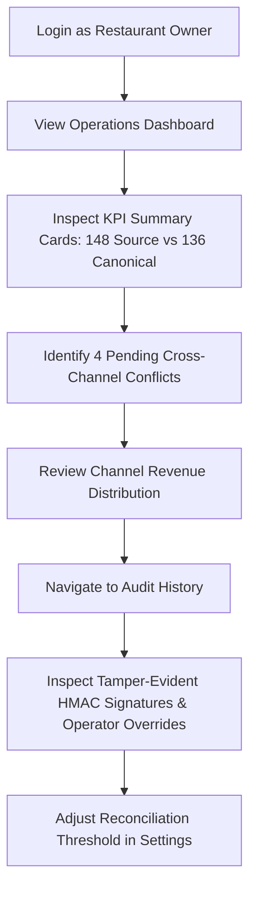
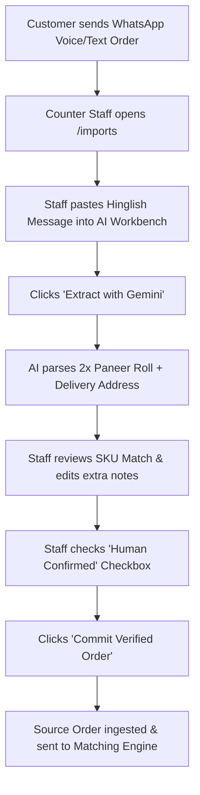
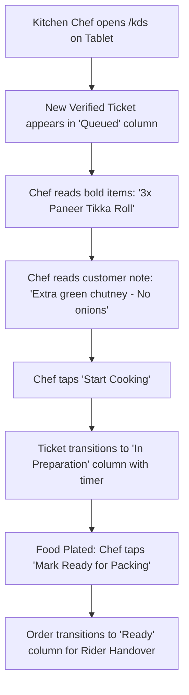
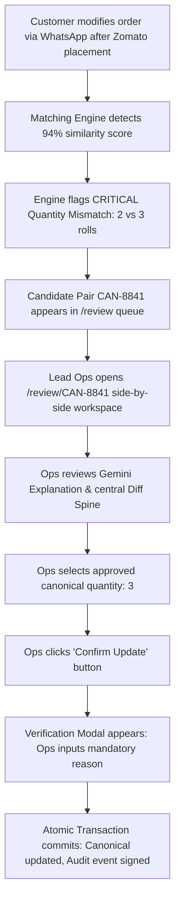

# 06 — User Flows & Role-Based Navigation Architecture

This document maps the end-to-end user journeys, navigation hierarchies, and role-based permissions across PakkaOrder AI.

---

## 1. Role-Based Permissions Matrix

| Operational Capability | Restaurant Owner (`OWNER`) | Operations Lead (`LEAD_OPS` / `MANAGER`) | Counter Cashier (`COUNTER_STAFF`) | Kitchen Chef (`KITCHEN`) |
| :--- | :---: | :---: | :---: | :---: |
| **View Operational Dashboard** | Full Access | Full Access | View Only | ❌ |
| **View Unified Orders Inbox** | Full Access | Full Access | Full Access | ❌ |
| **Access Conflict Review Queue** | Full Access | Full Access | View Only | ❌ |
| **Execute Conflict Resolutions** | ✅ Approved | ✅ Approved | ❌ Requires Escalation | ❌ |
| **AI WhatsApp Text Extraction** | ✅ Full Access | ✅ Full Access | ✅ Intake & Edit | ❌ |
| **Upload Batch CSV Settlements** | ✅ Full Access | ✅ Full Access | ❌ | ❌ |
| **Manage Menu SKUs & Aliases** | ✅ Full Access | ✅ Full Access | View Only | ❌ |
| **Access Cryptographic Audit Trail**| ✅ Full Access | View Only | ❌ | ❌ |
| **Modify Reconciliation Rules** | ✅ Full Access | ❌ Read Only | ❌ | ❌ |
| **Configure Webhooks & Channels** | ✅ Full Access | ❌ Read Only | ❌ | ❌ |
| **View Kitchen Display (KDS)** | View Only | View Only | View Only | ✅ Primary Workspace |

---

## 2. Navigation Structure

```
PUBLIC NAVIGATION
├── Logo & Tagline (Home: /landing)
├── Product Features (#features)
├── How It Works (#how-it-works)
├── Interactive Demo (#interactive-demo)
├── Live Prototype CTA (/login or /)
└── Operator Sign In (/login)

AUTHENTICATED APP SHELL
├── AppSidebar (Left Navigation)
│   ├── Brand & Version Badge (PakkaOrder AI v2.4)
│   ├── Outlet Switcher Dropdown (Spice Garden Indiranagar / Koramangala)
│   ├── SECTION: OPERATIONS
│   │   ├── 📊 Overview (/)
│   │   ├── 🛍️ Orders (/orders) [Count Badge: 148]
│   │   ├── ⚖️ Review Queue (/review) [Alert Badge: 4 Urgent]
│   │   ├── 📥 Ingestion & AI (/imports)
│   │   └── 🍳 Kitchen Display (/kds) [Role: Kitchen/Counter]
│   ├── SECTION: MANAGEMENT
│   │   ├── 📦 Product Catalog (/catalog) [Count Badge: 148]
│   │   ├── 🛡️ Audit History (/audit) [Cryptographic Shield Badge]
│   │   └── ⚙️ Settings (/settings) [Role: Owner]
│   └── Bottom Footer:
│       ├── Engine Health Indicator (🟢 MySQL 8.0 & Gemini Active)
│       └── Active Operator Profile Card (Avatar, Name, Role)
│
└── TopNavbar (Global Tools)
    ├── Mobile Hamburger Menu Toggle
    ├── Omni-Search Input (⌘K: Search by ID, Phone, Customer, Dish)
    ├── Sync Channels Button (Manual webhook poll & refresh)
    ├── Notification Center (Urgent conflict alerts popover)
    └── User Profile Menu (Switch Role, Switch Outlet, Sign Out)
```

---

## 3. The Four Core Operational Journeys

### Journey A: Restaurant Owner (Oversight & Compliance)

1. **Login**: Owner logs into console and confirms active branch (*Spice Garden - Indiranagar*).
2. **Dashboard Review**: Inspects high-level KPIs: 148 source orders processed into 136 canonical orders, meaning 12 duplicate preparation losses were prevented today.
3. **Audit Verification**: Opens `/audit` to verify operator justifications and ensure that no staff member performed unauthorized overrides without telephone confirmation.
4. **Policy Governance**: Reviews `/settings` to confirm that the strict zero-auto-merge quantity guardrail remains enforced.

---

### Journey B: Counter Staff (Intake & Multilingual AI Ingestion)

1. **Intake Event**: A regular customer sends an informal WhatsApp message: *"bhaiya 2 paneer roll aur 1 butter chicken bhej do jaldi prestige ozone indiranagar flat 402 me. payment gpay kardoonga. extra green chutney chahiye"*.
2. **AI Workbench**: Staff opens `/imports`, pastes the text into the Conversational AI pane, and clicks *"Extract with Gemini"*.
3. **Structured Verification**: The backend Gemini engine returns extracted line items, customer name, delivery address, and SKU mappings (`SKU-PAN-01` and `SKU-CHK-02`).
4. **Human Review**: Staff verifies that the customer wants 2 rolls and extra chutney, checks the human confirmation checkbox, and clicks *"Commit Verified Order"*.
5. **Engine Dispatch**: Record is created in `source_orders`, evaluated by the matching engine, and linked into the master queue.

---

### Journey C: Kitchen Staff (Kitchen Display & Order Preparation)

1. **Screen Setup**: Kitchen staff mounts a water-resistant tablet running `/kds` above the assembly counter.
2. **Ticket Arrival**: Reconciled canonical order `CAN-ORD-1042` appears in the *Queued* column with a green *WhatsApp Verified* badge.
3. **Execution**: Chef notes the verified quantity (3 rolls) and special instruction (*No onions*).
4. **Stage Transition**: Chef taps *"Start Cooking"*. The elapsed timer turns amber at 10 minutes. Once plated, chef taps *"Mark Ready"*, alerting dispatch staff for courier handover.

---

### Journey D: Operations Lead (The Core Conflict Resolution Flow)

1. **Conflict Trigger**: A customer places an order on Zomato for 2 Paneer Rolls. Five minutes later, the customer sends a WhatsApp message requesting 3 Paneer Rolls.
2. **Detection**: Heuristic engine calculates a 94% match based on phone number, delivery address, and time window. Because quantities differ (2 vs 3), the engine flags a `CRITICAL QUANTITY_MISMATCH` and refuses to auto-merge (Rule #6).
3. **Queue Notification**: Candidate pair `CAN-8841` appears in the Review Queue with an amber alert and 15-minute SLA countdown.
4. **Side-by-Side Review**: Lead Ops opens `/review/CAN-8841`. The split pane highlights the discrepancy: Left (Zomato: Qty 2) vs Right (WhatsApp: Qty 3). Gemini AI summarizes the customer's revision intent.
5. **Selection & Action**: Ops selects Canonical Quantity = 3, clicks *"Confirm Update"*.
6. **Mandatory Justification**: The verification modal requests an operator rationale. Ops selects *"Customer confirmed via WhatsApp message"* and signs as `Pranav M. (Lead Ops)`.
7. **Atomic Commit**: The backend transaction locks the row, updates canonical quantity to 3, preserves both original source records intact, and generates an HMAC-signed audit entry.
